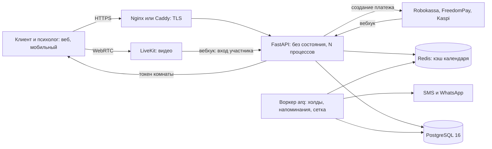
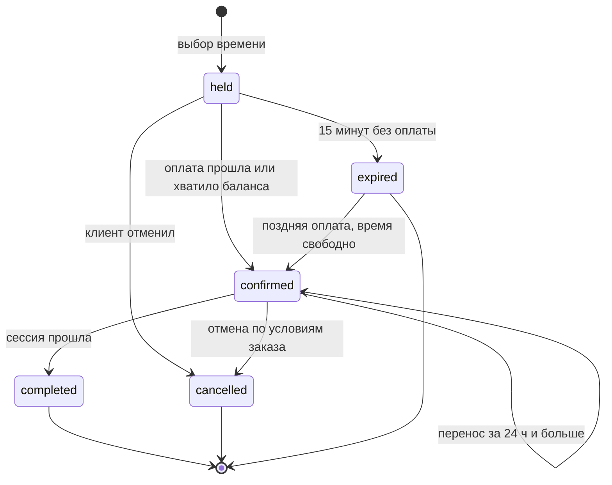
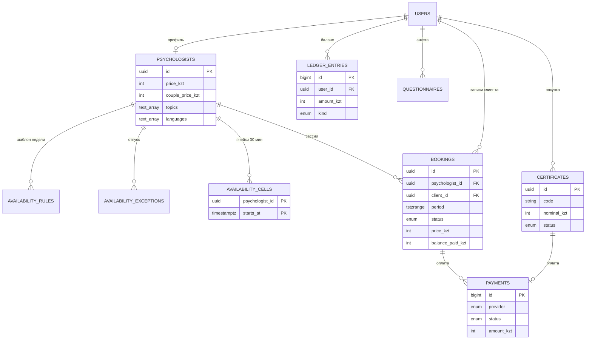

# Архитектура

## Компоненты

Масштабирование: API не хранит состояния — растёт добавлением процессов и серверов за балансировщиком. Следующие ступени — реплика PostgreSQL на чтение для календаря и подборки, отдельный сервер под LiveKit.

## Жизненный цикл записи

Две активные записи одного психолога не могут пересечься: это гарантирует ограничение `EXCLUDE USING gist` в PostgreSQL, а не код приложения.

## Схема данных

